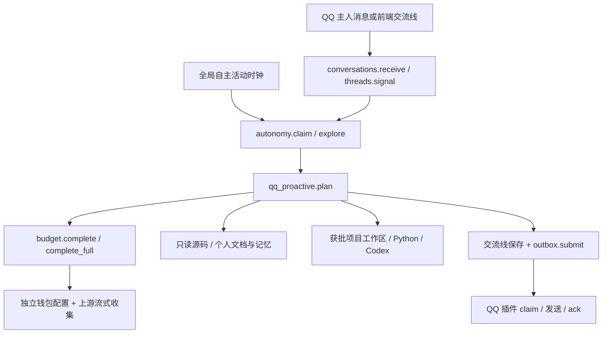

# 沙盒开发地图

核对日期：2026-10-23。自主活动与沙盒现为独立专家插件，见[专家模式说明](expert-mode.md)。表中的服务文件现位于 `features/autonomous-activity/autonomous_activity/services/`；路由位于该插件的 `routers/`，界面位于插件 `ui/src/`。旧的本体路径仅用于识别迁移前的符号，模板和 Dockerfile 已移到插件 `sandbox/`。

## 先理解三条路径



QQ 是输入与投递插件。全局生活调度不依赖普通 QQ 娱乐的开关、时段和频率。`say` 生成可投递动作，真实送达要看插件回执。

## 按问题读文件

| 问题 | 首选文件与符号 | 必要时继续追 |
| --- | --- | --- |
| 她不活动、重复唤醒、连续工作或休息 | `exploration_autonomy.py`: `claim`, `explore`, `_run` | `exploration_threads.py`: `signal`, `stamp`, `repeating_work` |
| 她说得拘谨、工具选错、JSON 错误 | `qq_proactive.py`: `plan`, `CONTEXT_VERSION` | `qq_stickers.py`: `parse_object`；`qq_conversation.py`: `parse_actions` |
| 上下文被截断、重复发送材料 | `qq_proactive.py`: `fit_context`, `compact_artifact`，`plan` 内 evidence 构建 | `exploration_threads.py`: `context`；个人记忆 `recall` |
| token 不足、usage 不一致、失败扣账 | `exploration_budget.py`: `reserve`, `settle`, `complete_full`, `blocking_unknown_in` | `exploration_wallet.py`: `configuration`, `valid_in`, `provider_balance_in` |
| 项目申请、批准、暂停、权限 | `exploration_projects.py`: `request_more`, `approve`, `attach`, `check_run` | `backend/app/routers/exploration_projects.py`: `local_dashboard` |
| 读主项目文件被拒绝 | `exploration_workspace.py`: `reference_index`, `read_reference`, `snapshot` | `qq_proactive.plan` 的 `reference` 分支；别先去改 project grant |
| 写文件没落盘或容器成果丢失 | `exploration_workspace.py`: `write`, `files`, `execute` | `exploration_memory.py`: `document`；区分草稿、个人 docs、项目文件 |
| Codex 调用报错、工具协议或计费 | `exploration_workspace.py`: `execute` | `exploration_agent.py`: `translate`, `respond`；`backend/sandbox/agent_runner.py` |
| 自己的记忆、主库观察或手册 | `exploration_memory.py`: `memory`, `recall`, `docs`, `observe`, `bundle` | `memory_workflow.py`；`backend/sandbox/personal-docs/` 是模板 |
| QQ 收到消息但不回 | `features/qq-bridge/qqbridge/conversation.py`: 沙盒分流 | `exploration_conversations.py`: `receive`；线程状态；`exploration_outbox.py` |
| 有 proposal 但 QQ 没送达 | `exploration_outbox.py`: `submit`, `claim`, `acknowledge` | `features/qq-bridge/qqbridge/proactive.py`；账号绑定与回执 |
| 流式请求像卡住 | `backend/app/providers/openai.py`: `stream_chat`, `collect_chat_stream` | `exploration_budget.complete_full`；沙盒收齐并校验后才发布 |

## 三种文件、两种记忆

| 内容 | 访问通道 | 持久性与范围 |
| --- | --- | --- |
| 主项目源码快照 | `reference` | 只读，无需项目 grant；是筛选后的源码，不含宿主凭据和运行数据 |
| 自己的个人笔记 | `personal_docs`，`operation=write` | `backend/data/sandbox-personal/<角色身份哈希>/docs/`；无需项目 grant |
| 项目工作区文件 | `read_file/write_file/execute/agent` | 需要对应项目授权；临时容器改动要经过导出才能持久保存 |
| 活动草稿 | `document` | 账本 artifact，不是写入个人 docs 或实现功能 |
| 自己的独立记忆 | `personal_memory` | 复用主项目记忆逻辑，隔离存储，可自主审核 |
| 当前用户全角色聊天、主记忆 | `recent_chats/observe_memory` | 只读观察，保留来源；不会自动变成自己的亲历 |

## 限制实际在哪里

| 设置或保护 | 代码位置 | 当前含义 |
| --- | --- | --- |
| 全局配置 | `exploration_autonomy.settings_in` | `feature_settings` 的 `autonomous_activity`；旧 QQ 配置只作迁移默认 |
| 连续工作分段 | `exploration_autonomy.explore` | 每段 6 次调用 / 600 秒；有明确下一步可立即接续，段数不是总预算 |
| 后台扫描 | `exploration_autonomy._run` | 普通等待 20 秒扫描；可连续接续，不等于每 20 秒必调模型 |
| 额度参数夹取 | `exploration_budget.limits` | 本地单段上限 50,000、日上限 200,000；默认 12,000 / 24,000 |
| 上游余额模式 | `exploration_wallet.provider_balance_in` + `budget.reserve/settle` | 普通活动与有项目 grant 的分支不同；勿只看 limits 推断实际可花额度 |
| 上下文预览 | `qq_proactive.fit_context` | 普通上游余额模式使用 64,000 的预览估算空间，不是授予新额度 |
| 真实计量入口 | `budget.complete_full` | 累计输入与输出；重试、顾问和子 agent 都要计入 |
| 格式修复 | `qq_proactive.plan` 的 ValueError 分支 | 完整响应最多纠正一次；复用原 run 与预算，重复错误停止；上游/用量失败不当作格式重试 |
| 重复工具空转 | `exploration_threads.repeating_work` | 最近三个工具结果完全相同，停止连续工作；别用删除账本规避 |
| agent 任务长度 | `exploration_workspace.execute` | 1–1600 字；当前只接通 Codex，Claude 未实现 |
| 文件容量 | `exploration_workspace.MAX_FILE/MAX_TOTAL/MAX_FILES` | 单文件 32,000 字节、总 256,000 字节、30 文件 |
| 容器与超时 | `exploration_workspace.command/execute`、`BOOTSTRAP` | 断网、只读根、非 root、资源限制；agent 有单独参数，改前读相应分支 |
| 审批入口 | router `local_dashboard` + `projects.approve` | 用户在前端批准；聊天同意本身不创建 grant |

这些是定位事实，不是建议把所有保护都写进人格提示词。已有权限内鼓励直接探索；新预算、宿主边界与隔离由程序检查。

## 状态、记录与界面

- `exploration_clock` 是全局调度租约；`exploration_threads` 是每个 persona/speaker 的生活状态与接力。`error`、`waiting_resources` 结合 `blocked_stamp` 判断是否仍需等待；`paused` 尊重显式暂停。
- `exploration_runs` 是一段执行；`exploration_calls` 是各次模型调用的预留、usage 与结算；`exploration_artifacts` 是工具结果、草稿、计划、错误和提议。run 结束不等于文件作废，也不等于消息送达。
- grant、钱包、线程、容器 job 和 outbox 是不同状态。诊断时用 run_id 与 persona/speaker 串联，不根据一句“已完成”推断执行成功。
- 前端入口：`frontend/src/components/AutonomousActivityPanel.tsx`；活动控制 `AutonomyControl.tsx`，记录与项目 `QqExploration.tsx` / `ExplorationProjects.tsx`，个人记忆 `SandboxPersonalMemory.tsx`。
- API：`backend/app/routers/exploration_projects.py` 与 QQ router；真实密钥、登录态、整份配置不进入排查报告。

## 按改动选择验证

在项目根目录运行 PowerShell，使用已有虚拟环境；以下命令均为离线用例，特定 Docker 套件除外。

```powershell
# 格式失败后保留成果、有限修复与停止空转
backend/.venv/Scripts/python.exe -m unittest discover -s backend/tests -t backend -p test_sandbox_life.py
# 项目审批、文件边界与只读快照
backend/.venv/Scripts/python.exe -m unittest discover -s backend/tests -t backend -p test_exploration_projects.py
# 钱包/时钟、个人记忆：分别按涉及模块选择文件
backend/.venv/Scripts/python.exe -m unittest discover -s backend/tests -t backend -p test_exploration_autonomy.py
backend/.venv/Scripts/python.exe -m unittest discover -s backend/tests -t backend -p test_exploration_memory.py
```

更细粒度：进入 `backend` 后用 `.venv/Scripts/python.exe -m unittest tests.test_sandbox_life.LifeTests.<方法名>`。Codex 协议测试选 `tests.test_exploration_agent.AgentTests`；该文件的其他测试可能用真实 Docker，但 provider 为假实现。QQ 接线选 `tests.test_qq_conversation` 的相关方法。

前端修改按 `frontend/package.json` 的现有命令做类型检查；浏览器用例在 `frontend/tests/qq-exploration.mjs`。无需为纯文档改动跑整套应用测试。用例通过后，只有新修改、失败或未决疑点才需要扩大验证。

## 容易重复踩的坑

1. `db._tx()` 不可重入；事务内调用再次开事务的服务会卡住。需要复用连接时查对应 `*_in(c)`。
2. 源码快照放系统临时目录 `snapshot_base()`，不是 `backend/data`：后者放 `.py` 曾触发 uvicorn reload、中止模型请求。
3. 普通 git diff 不显示 `??` 文件的内容。先留文件副本再比较，无需反复全文重读，也不要顺手提交无关工作。
4. 新增 agent 名字、JSON 字段或提示词不是实现新通道；必须同时核对函数签名、镜像、协议、授权、计量和回归。
5. 调用次数、缓存输入、总输入与费用不是同一个指标；供应商缓存原因和真实金额没有回执就标未知。

接力模板与最近状态见 开发交接（不随内核分发）。使用说明见 [小工作室](exploration-workshop.md)。
