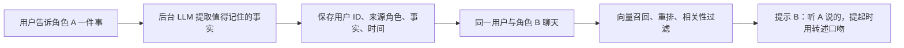

# Eidolon-SC：通话立绘、共享记忆与角色声音

调研日期：2026-10-19。通过 OmniReach CLI 读取 GitHub 页面和 raw 源码，使用本机 7897 HTTP 代理。本文是对当时 main 的静态核对，没有测量演示站延迟，没有调用声音模型，也没有获取作者未公开的素材或训练数据。本轮只新增调研文档。

## 1. 立绘为何会动

仓库采用 **Spine**，与 Live2D 同属可用于二维角色表现的技术，但资源、骨骼和运行时并不通用。作者使用原作已有的 Spine 立绘及动画；代码负责根据对话事件选择动作，并非现场生成角色动作。

主要证据：[standAnimations.ts](https://github.com/Sallyn0225/eidolon-sc/blob/main/frontend/src/lib/standAnimations.ts)、[standDirection.ts](https://github.com/Sallyn0225/eidolon-sc/blob/main/frontend/src/lib/standDirection.ts)、[emotion.py](https://github.com/Sallyn0225/eidolon-sc/blob/main/backend/src/eidolon/emotion.py)、[call.py](https://github.com/Sallyn0225/eidolon-sc/blob/main/backend/src/eidolon/call.py)。

| 输入或状态 | 表现方式 |
|---|---|
| 每段回答的情绪 | 平静、开心、害羞、惊讶、难过、生气、思考，映射已有身体和面部动画 |
| 角色正在说话 | 播放当前情绪的嘴部循环；结束后停在闭嘴帧 |
| 用户正在说话 | 视线看向用户，并根据事件触发倾听反馈 |
| 肯定或否定 | 点头或摇头的一次性动画 |

身体、面部、嘴部、点头和视线分配到不同 Spine 轨道，因而可以叠加。缺少某个动作时按候选名称回退，例如没有对应情绪嘴形时使用通用嘴部动画。

后端辅助判断模型为完成的回复片段预测情绪及点头类型，异步发送结果。回复与片段编号把结果对应到音频；前端缓存还没开始的片段结果，丢弃已经播完片段的迟到结果。`segment_playing` 在该片段第一批音频之前排入输出队列，减少表情提前切换。音频和数据的传输、播放仍可能引入误差，不能等同逐采样同步。

这条嘴部链路按 speaking 状态循环已有动画，未体现逐音素嘴形驱动。生动感来自专业素材、叠加动作、情绪选择和播放时序共同作用。引入我们项目时，需要准备自己可使用的立绘资源及其动作映射；安装运行库本身不会得到同等角色表现。

## 2. 记忆如何“传染”

作者在 [ADR-0002](https://github.com/Sallyn0225/eidolon-sc/blob/main/docs/adr/0002-shared-memory-with-source-character.md) 明确规定：**同一用户的所有角色共享记忆，每条记忆记录来源角色**。不是多个角色在后台真的互相聊天，也不涉及修改模型权重。

[memory.py](https://github.com/Sallyn0225/eidolon-sc/blob/main/backend/src/eidolon/memory.py) 的实现细节：

- 每轮后异步抽取中文事实，避免把全部聊天记录塞给所有角色。
- 根据用户 ID 查询记忆，跨角色共享范围限于同一用户。
- 用当前消息及前一条角色回答组成查询，处理“它”“那件事”等指代；向量选出最多 12 个候选，再用重排模型及相关性阈值筛选。
- 提示词分别写明“制作人对你说的”和“制作人对某角色说的，你是听她说的”，后者要求用转述口吻。这是模型行为要求，不是绝对保证。
- 新信息可取代过时信息，例如搬家、换工作；旧记忆标记为已被取代，而非继续参与有效记忆召回。
- 异步写入、清空期间的旧任务和向量补算都有专门处理，减少下一轮读不到新事实、清空后又冒出旧事实的问题。

**它有一个明确的产品取舍：用户说“别告诉某某”，也照样共享。** ADR 直说当前没有角色私密记忆，未来可加可见范围字段。我们可以借鉴来源归属和转述机制，但应结合本项目已有的私密/共享记忆规则设计，不应直接照搬这一点。

## 3. 音色、语气、发音分别由什么负责

| 层 | 已核实实现 | 对听感的作用 |
|---|---|---|
| 音色 | 角色配置 `voice_id`，Fish 请求 `reference_id` | 指定使用哪一个托管声音资源 |
| 语言风格 | 角色 sheet、人物资料、对话上下文、检索内容 | 用词、称呼、口癖、礼貌程度、句长和人物关系 |
| 逐句表演 | 回复内的英语方括号提示；Drama 3 另支持特定成对标签 | 害羞、笑声、轻声、强调等表达意图，效果取决于模型 |
| 专名发音 | readings 与 Fish pronunciation dictionary | 减少角色名及特殊词汇的读音错误 |
| 画面表现 | 独立情绪判断及前端播放状态 | 把面部、身体、嘴部动作接到正在播放的片段 |

证据：[characters.toml](https://github.com/Sallyn0225/eidolon-sc/blob/main/characters/characters.toml)、[真乃角色设定](https://github.com/Sallyn0225/eidolon-sc/blob/main/characters/sheets/mano.md)、[delivery_cues.py](https://github.com/Sallyn0225/eidolon-sc/blob/main/backend/src/eidolon/delivery_cues.py)、[engine.py](https://github.com/Sallyn0225/eidolon-sc/blob/main/backend/src/eidolon/engine.py)、[call.py](https://github.com/Sallyn0225/eidolon-sc/blob/main/backend/src/eidolon/call.py)。

例如真乃 sheet 具体规定温柔、慢热、稍有犹豫，使用「わたし」「プロデューサーさん」，列出「ほわっ」「むんっ」等口癖，以及です・ます体、短句、停顿和不同伙伴称呼。这些首先影响生成出来的台词；只复用声音 ID，并不会自动拥有这些行为。

`delivery_cues.py` 将显示文本与合成文本分开：字幕不展示表演标记，TTS 接收合法的英语方括号提示。Drama 3 可接收 `whisper`、`emphasis`、`soft`、`fast`、`slow`、`stress`、`forceful` 成对标签；其他模型会去掉这些成对标签。该文件也过滤一些错误格式，降低模型把舞台指令读出声的机会。支持这些输入不表示每次都能精确实现要求的情绪。

声音表演和动画情绪是两条协调的支路：前者由合成文本提示驱动，后者由辅助模型判断并映射动画。不能把“情绪判断模型”理解为直接训练或克隆声音的模型。

## 4. 没有公开的关键部分

[ADR-0003](https://github.com/Sallyn0225/eidolon-sc/blob/main/docs/adr/0003-corpus-and-voices-stay-private.md) 提到作者自己克隆的音色，后续允许在 Fish 上公开，以便用户自带密钥调用；这能证明声音资源的使用路径。角色配置要求 BYOK 可访问的公开声音 ID。

**此次查到的公开代码和文档没有给出这些角色音色的完整制作配方**：原始录音、选段标准、清洗标注、训练/适配参数、质量评估和复现指标均无法据此确认。不能根据一个 `voice_id` 推断作者用了多少分钟素材、是否专门微调，或用什么训练流程。

原作 Spine 素材、角色声音模型和剧情原始资料不随代码仓库分发。部署和调用代码可以研究，复现角色效果仍需另外准备相应资源。落地页招呼与演示开场白还使用预先合成的桶内音频，不能拿这部分体验直接推断实时生成延迟。

## 5. 对本项目的建议

先在已接入的语音通话上做一个角色的完整样板：确定可用声音资源，完善该角色的语言风格，接入模型支持的表演提示与专名读音，再用真实对话检查长句、轻声、笑声和打断后的衔接。

动画可独立增加：约定情绪、说话、倾听、点头等状态，再映射到我们实际拥有的 Spine 或 Live2D 资源。不要把特定素材的动作名直接写成整个项目的通用接口。

共享记忆值得借鉴的是“事实来源 + 可见范围 + 转述口吻”。对我们来说，应先复核现有记忆权限，再决定哪些信息能被其他角色知道。此次没有修改本项目记忆规则、添加动画或制作声音模型。
