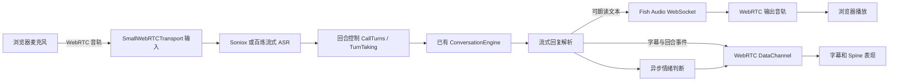

# Eidolon-SC 的 ASR、TTS 与实时通话实现调研

调研日期：2026-10-19（北京时间）。通过本机 OmniReach CLI 的 `fetch --json --backend http` 读取 GitHub 页面及 raw 源码，请求设置 HTTP/HTTPS/ALL_PROXY 为 `http://127.0.0.1:7897`。这是对当时 `main` 的静态阅读，没有实际拨号、调用付费语音 API 或测量端到端延迟；下文服务表现及免费额度仅代表该仓库的实现和说明，未经服务商独立核验。本轮没有修改本项目业务代码。

## 1. 结论

最值得借鉴的是语音管线和回合控制，而不只是接入 Soniox、千问或 Fish Audio：

- 浏览器到后端用 WebRTC；后端用 Pipecat 组织流式 ASR、对话引擎、流式 TTS。
- 语音和文字复用同一个对话引擎与会话记录，没有再维护一个独立的语音大脑。
- 大模型文本边生成边解析、分句合成，不等完整回复。
- 单独处理用户补充、插话打断、合成取消和播放队列清空。
- 用回复编号与分段编号，把音频、字幕和表情对应起来。

它采用 ASR → 文本 LLM → TTS 组合方案，并非一个端到端语音模型。双向音频持续传输，回答仍按回合进行。

## 2. 整条链路



后端实际 Pipeline 的顺序是：

`transport.input → stt → UserTurnProcessor(ExternalUserTurnStrategies) → CallTurns → tts → transport.output`

没有使用 Pipecat 自带的 LLM 服务或上下文聚合器。`CallTurns` 调用项目自己的 `ConversationEngine.turn()`，使记忆、检索、角色设定和文字聊天共用。

前端使用 `@pipecat-ai/client-js` 与 `@pipecat-ai/small-webrtc-transport`。先取通话配置及 ICE 服务器，再开麦克风，通过 `/api/offer` 做 WebRTC 信令。角色音频走远端音轨；识别候选、回复增量、说话状态等走数据通道。通话中打字也能触发同一套回合控制。

来源：[call.py](https://github.com/Sallyn0225/eidolon-sc/blob/main/backend/src/eidolon/call.py)、[前端 call.ts](https://github.com/Sallyn0225/eidolon-sc/blob/main/frontend/src/lib/call.ts)。

## 3. ASR 如何实现

| 项目 | Soniox | 百炼 / 千问 |
|---|---|---|
| 选择方式 | `STT_PROVIDER=soniox`，默认 | `STT_PROVIDER=bailian` |
| 密钥 | `SONIOX_API_KEY` | `DASHSCOPE_API_KEY` |
| 模型 | 使用 Pipecat Soniox 服务默认值，项目该处未明确指定模型名 | 当前代码限定 `qwen-audio-3.1-asr-flash-streaming` |
| 接入 | 包装 Pipecat `SonioxSTTService` | 自写 `BailianSTTService` 适配 Pipecat |
| 语言 | 中文、日语提示 | 中文、日语提示 |
| 热词 | Soniox context 的 terms | 每个任务携带 vocabulary |

不能把视频里泛称的“Qwen ASR”直接理解为随便选一个千问模型名：当前仓库对百炼型号和协议做了明确限制。Soniox 的具体默认型号还取决于所安装的 Pipecat 版本。

百炼的具体处理：

1. 使用北京或新加坡 DashScope WebSocket `/api-ws/v1/inference`，通过任务协议 `run-task` 启动，等 `task-started` 后发音频。
2. 音频重采样为 **16 kHz、16-bit、单声道 PCM**，每包 **100 ms**，即 3200 字节。
3. 设置 `vad_model=near_meeting_16k`、`language_hints=[zh, ja]`、`heartbeat=true`。断句交给服务商，未另挂一层本地 Silero VAD。
4. 收到含有效文字的第一条候选，才发“用户开始说话”事件；候选转成 `InterimTranscriptionFrame`；`sentence_end` 的最终文本转成 `TranscriptionFrame`。
5. 心跳、空文本不当作有效话语。静音等无音频输入期间，适配器每约 1 秒补发 100 ms 静音包，防止任务因闲置结束。
6. 读音表、角色中文名和组合名组成热词。普通热词权重 4；部分拉丁字母专名使用更高权重。这个权重是该项目的场景调校，不应直接用于所有词。

Soniox 路径设置 `vad_force_turn_endpoint=False`，同样由 ASR 提供话语边界。`ExternalUserTurnStrategies` 将服务提出的说话状态变为 Pipecat 回合和打断事件。

百炼代码注释称默认停顿阈值为 1.3 秒，并记录了作者的测试表现；这不是我们实测，也不是整条通话延迟。识别速度、断句速度、回答首字和 TTS 首包需要分别测量。

来源：[bailian.py](https://github.com/Sallyn0225/eidolon-sc/blob/main/backend/src/eidolon/bailian.py)、[hot_words.py](https://github.com/Sallyn0225/eidolon-sc/blob/main/backend/src/eidolon/hot_words.py)（热词组装入口由 call.py / assembly.py 引用）、[config.py](https://github.com/Sallyn0225/eidolon-sc/blob/main/backend/src/eidolon/config.py)。

## 4. TTS 如何做到较快开口

角色配置提供 `voice_id`，请求 Fish Audio 时作为 `reference_id`，音色模型本身不在代码仓库。模型选择目前为 `s2.1-pro-free`（默认）、`s2.1-pro`、`drama-3`、`s2-pro`、`s1`；代码校验型号，防止拼错后服务端按其他型号合成。

LLM 输出交替的日语与中文字幕：

```text
<ja>[shyly] ありがとう。</ja><zh>谢谢你。</zh>
```

流式解析器分别产生展示增量、朗读增量与分段完成事件。日语内容到达即可进入 TTS 的句子聚合器；不必等整条回复，段落结束时强制送出聚合器剩下的文本。

`FishTTS` 继承并扩展 Pipecat 的 Fish 服务，用 MessagePack 编码 WebSocket 事件：

- `start`：携带音色、采样率、音频格式、韵律参数和读音字典；模型放在请求 header。
- `text` → `flush`：提交聚合后的文本并催送音频。
- `audio`：收到音频后包装为 `TTSAudioRawFrame`，进入 WebRTC 输出。
- `stop` / `finish`：收完当前段再进入下一段；等待段尾最长 10 秒，超时舍弃余下部分。

一个回复分段使用一个独立 Fish 会话。为抵消新连接开销，当前段合成时就**预先连接下一段**，最后还保留备用连接供下个回合使用。源码注释提到建连可能耗时一秒或更长，这也是预连接的动机，不能据此承诺无停顿。

声音语气由主模型生成的提示控制，如 `[shyly]`。Drama 3 另支持更长导演提示及 `<whisper>…</whisper>` 等局部标签；切到不支持的模型时过滤局部标签。提示可以送给声音合成，但界面展示会滤掉。专名读音通过 `pronunciation_dictionary` 注入。

来源：[call.py 的 FishTTS / InterruptsFirst](https://github.com/Sallyn0225/eidolon-sc/blob/main/backend/src/eidolon/call.py)、[reply_format.py](https://github.com/Sallyn0225/eidolon-sc/blob/main/backend/src/eidolon/reply_format.py)、[delivery_cues.py](https://github.com/Sallyn0225/eidolon-sc/blob/main/backend/src/eidolon/delivery_cues.py)。

## 5. 补充、打断和状态同步

`TurnTaking` 是独立状态机，`CallTurns` 负责执行它返回的命令：

- **角色尚未开口并形成完整分段时，用户补充**：放弃当前回复，清掉待播语音，把补充内容并入同一用户回合，重新回答。代码判定同时参考角色是否已开口/回复已记录及是否已有完整分段，不只看 LLM 有没有开始输出。
- **角色已开口且已有完整分段后，用户插话**：停止当前回复，保留已生成的完整分段，用户新话进入下一回合。这里的存储边界是完整文本分段，不是逐字核对用户实际听到了多少音频。
- **开始说话却没有有效转写**：若先前回复因补充而放弃，等待超时后用原用户内容重新回答。Soniox 等待 4 秒，百炼 3 秒；这两个值是补充转写等待，不是常规断句阈值。
- **停声优先**：`InterruptsFirst` 立即向播放方向传递打断，重连 Fish 放在后台，下一次合成等待重连完成。否则重连时间会拖延停止播放。

各段带 `reply` / `segment` 编号。后端把 `segment-playing` 放在该段首帧音频之前的同一输出队列；前端用它协调字幕/表情。它比文本生成时间更接近播放时间，但源码阅读不能证明跨音轨和数据通道达到逐采样同步。

情绪判断是独立异步任务：每个完整分段判断七种表情及点头/摇头，带置信度阈值和超时，失败不阻塞说话。前端提前收到则缓存，播放该段时应用；该段过去后才返回则丢弃。**Jev 在这里控制立绘表现，Fish 的语气由主模型提示控制，两者不是同一条链。** 本次查看的方向控制代码按播放状态驱动动嘴，未证明它有音素级口型。

来源：[turn_taking.py](https://github.com/Sallyn0225/eidolon-sc/blob/main/backend/src/eidolon/turn_taking.py)、[emotion.py](https://github.com/Sallyn0225/eidolon-sc/blob/main/backend/src/eidolon/emotion.py)、[standDirection.ts](https://github.com/Sallyn0225/eidolon-sc/blob/main/frontend/src/lib/standDirection.ts)。

## 6. 与本项目的差异

| 部分 | 本项目当前代码 | Eidolon-SC |
|---|---|---|
| ASR | 浏览器 Web Speech，按住说话，结果进输入框 | 后端 Soniox / 百炼流式识别与话语边界 |
| TTS | Edge / Piper；后端先收完整音频，前端再取完整 Blob 播放 | WebSocket 收音频后持续送入 WebRTC |
| 回复衔接 | 主要为手动朗读；`autoSpeak` 当前固定初始化为 `false`，没有对应 setter | LLM 分段生成期间即可合成 |
| 打断 | 播放令牌作废旧结果，暂停旧 Audio；本次所读 `speakText` 没有 AbortController 取消后端合成 | 回合状态机、停止生成、清音频队列及后台重连 |
| 通话入口 | 提示“语音通话尚未接入” | 完整通话连接、结束原因、设备切换和限额管理 |

本地依据：`frontend/src/hooks/useSpeechToText.ts`、`frontend/src/components/ChatView.tsx`、`backend/app/routers/voice.py`。README 的“自动朗读”描述与当前代码存在差异，以本轮工作区代码为准。

本项目后端 Edge 虽调用 `com.stream()`，但把所有音频累积完才返回 `Response`；前端又 `await resp.blob()` 后创建 `Audio`。**底层 SDK 能流式输出，不等于产品已经流式播放。** Piper 同样先收完整 chunks，再组装 WAV。

## 7. 适合本项目的借鉴顺序（建议，尚未实施）

1. **保留语音引擎可替换接口。** 当前项目要求 §6 以 sherpa-onnx / 本地轻量 ASR 优化为方向，Piper、Edge 要保留。可增加百炼或 Soniox 作为可选云端 ASR，Fish 作为可选音色服务；不把云服务变成必需依赖。
2. **先统一事件和回合控制。** 定义 `interim/final`、`reply_id/segment_id`、播放开始/停止、取消和错误事件。直接复用现有聊天、人设和记忆链路，避免语音拥有第二套历史。
3. **做中文分句合成和播放队列。** 不需要照搬日语加中文字幕协议，也不需要为了语音拆分破坏角色卡的原始消息。可以在朗读支路分句，先完成回复过程中分段送合成、顺序播放、取消在途请求和清队列。现有 Edge/Piper 分句能降低部分等待，但仍需区分与连续音频流的差距。
4. **需要持续开麦和随时插话时，再接 Pipecat / WebRTC。** 把本地 ASR 和可选云端 ASR 包成同一种服务接口，沿用同一套回合状态机。若以后只做“按住说话 → 自动发送 → 自动朗读”，可以先用现有 HTTP/SSE 完成，不必提前引入全部 WebRTC 部署。
5. **表情最后接入。** 语音播放事件应独立于 Spine、Live2D 或桌宠实现；情绪判断异步执行，超时保持默认表情，先保证说话链路不会被动画卡住。

它提供了原项目 §18 除“半自动方案”和“端到端实时 API”之外的一个清晰选项：**保留文本大脑，用流式 ASR + 流式 TTS + 实时传输实现通话。** 这条路也适合保留毕设的本地 ASR 替换位置。

部署需注意本项目已有 HTTP 隧道不能自动代替 WebRTC 媒体链路。Eidolon-SC 生产环境另外提供 coturn、ICE/TURN 配置，以支持跨网络通话。实际选型应测试手机/电脑、耳机/外放、静音恢复、弱网断线以及打断后的旧音频残留。

建议分别记录用户最后发声到 ASR final、LLM 首个可朗读分句、TTS 首音频、浏览器实际开始播放和插话到停声的时间，再用中位数与高分位数评价。当前阅读无法替代这些实测。

## 8. 范围与其他参考

- 仅调查语音相关代码，没有验证在线演示的当前配置和体验，也没有使用个人密钥或消费额度。
- 阅读的是动态 `main`，本次没有固定提交 SHA；后续实现前应重新核对依赖版本和服务协议。
- 该仓库声明 AGPL-3.0-or-later。若决定直接复用代码，需要按其许可证处理；本轮只是阅读与方案比较。语音、立绘等素材不随代码许可证自动授权。
- [仓库 README](https://github.com/Sallyn0225/eidolon-sc)、[配置指南](https://github.com/Sallyn0225/eidolon-sc/blob/main/docs/configuration.md)、[部署指南](https://github.com/Sallyn0225/eidolon-sc/blob/main/docs/deploy.md)、[依赖声明](https://github.com/Sallyn0225/eidolon-sc/blob/main/backend/pyproject.toml)。
